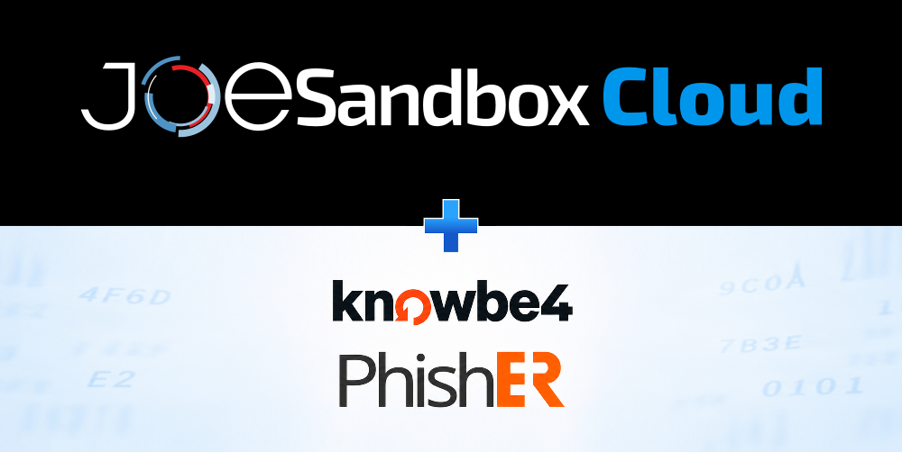
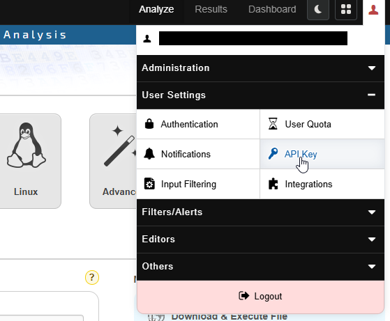
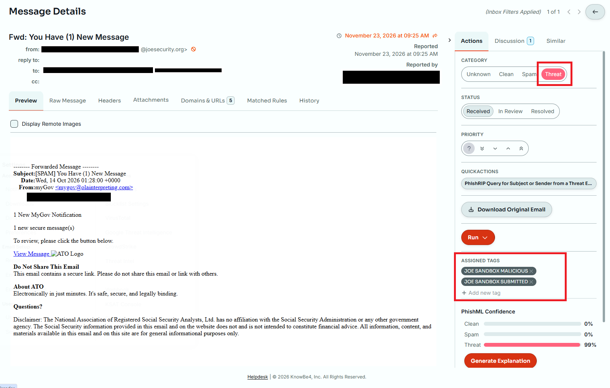
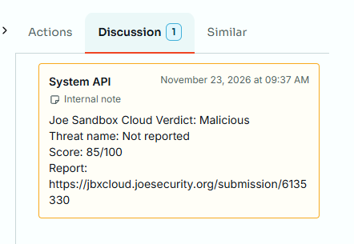
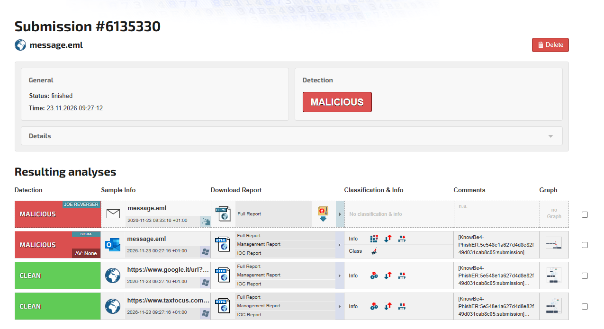

# Joe Sandbox Cloud for KnowBe4 PhishER

Investigate reported emails directly in your [PhishER](https://www.knowbe4.com/products/phisher-plus) inbox. The connector sends selected emails, including their headers, body, and attachments, to [Joe Sandbox Cloud](https://www.joesecurity.org/joe-sandbox-cloud) for analysis. By default, the connector also uses [Joe Reverser](https://www.joesecurity.org/joe-reverser) to investigate phishing and malware when your account includes it. It posts the verdict, available threat names and score, and a link to the submission in the message’s **Discussion** panel. Your team can triage the email in PhishER and open the full analysis when needed.

## Requirements

- A KnowBe4 PhishER account and a Product API token with access to PhishER.
- A Joe Sandbox Cloud account with an API key for submitting emails and viewing results.
- A host with Docker Engine and Docker Compose installed.
- Outbound HTTPS access from that host to KnowBe4, PhishER email download URLs, and Joe Sandbox Cloud.

## Install and start

1. From the connector directory, copy the example configuration for a new installation.

   ```sh
   cp config.example.toml config.toml
   ```

2. Enter your PhishER Product API token and Joe Sandbox Cloud API key in `config.toml`. If your KnowBe4 account is outside the US, set the endpoint for your region. See [Configuration options](#configuration-options) for the settings.

   To create your PhishER token, follow [Creating a Product API Token](https://support.knowbe4.com/hc/en-us/articles/10495383627155-Product-API-Overview#h_01HBDX0KNGC7G7ZNH6XBH3NZW0) in KnowBe4’s [Product API Overview](https://support.knowbe4.com/hc/en-us/articles/10495383627155-Product-API-Overview). Enter the token as `product_api_token` under `[knowbe4]`.

   To find your Joe Sandbox Cloud API key, open the account menu in the upper right and select **User Settings → API Key**. Enter the key as `cloud_api_key` under `[joe_sandbox]`.

   

### Choose Which Messages Are Analyzed

By default, the connector sends **all eligible messages** to Joe Sandbox Cloud, including messages already in your PhishER inbox when you first start it. A message is eligible once PhishER has processed it, while it is still unresolved and has no connector status or result tag.

To narrow the selection, edit the existing `[knowbe4]` section in `config.toml` before starting the connector.

- **Select by tag.** Set `required_tag = "Joe Sandbox Request"` and apply that tag in PhishER to the emails you want analyzed.
- **Select by search.** Set `email_search` to a PhishER search query. For example, `email_search = 'subject: "invoice"'` selects eligible emails with “invoice” in the subject.

If you set both filters, a message must match both. Leave both empty to use the default.

### Start the connector

Build the connector, validate the configuration file, and start it in the background.

```sh
docker compose build
docker compose run --rm connector check-config
docker compose up -d connector
```

## Verify the installation

1. Open a processed, unresolved message in PhishER and select **Actions**. Under **Assigned Tags**, `Joe Sandbox Submitted` confirms that Joe Sandbox accepted the email. A malicious or suspicious result adds the corresponding verdict tag. The example below shows a malicious result with the default **Threat** category.

   

2. Select **Discussion** to see the analysis details. In this example, Joe Sandbox returned a **Malicious** verdict with a score of **85/100**. Open the link under **Report** to view the submission in Joe Sandbox Cloud.

   

3. On the Joe Sandbox Cloud submission page, look under **Resulting analyses** and select **Full Report** for the analysis you want to inspect. In this example, both Joe Reverser and Joe Sandbox marked `message.eml` as malicious.

   

If the result does not appear, check the connector logs with `docker compose logs --tail=100 connector`.

## PhishER message tags

Open a message in PhishER and select **Actions → Assigned Tags** to see its submission status and verdict.

| Tag | What it means |
| --- | --- |
| `Joe Sandbox Submitted` | Joe Sandbox Cloud accepted the email. This tag stays on the message after analysis finishes. |
| `Joe Sandbox Malicious` | The overall verdict is **Malicious**. By default, the connector also sets the PhishER category to **Threat**. |
| `Joe Sandbox Suspicious` | The overall verdict is **Suspicious**. The PhishER category stays as it was. |
| `Joe Sandbox Error` | The connector recorded a failure while processing the message. Check the connector logs for details. |
| `Joe Sandbox Timeout` | The wait for submission or results exceeded `max_wait_seconds`. An accepted analysis may still finish in Joe Sandbox Cloud. |

For **Clean** and **Unknown** results, the connector records the verdict in **Discussion** without adding a verdict tag.

If you use `required_tag` to select messages, the connector removes that request tag after applying `Joe Sandbox Submitted`. Other tags your team applies are preserved.

## Configuration options

Edit the matching section in `config.toml`. Keep this file private and readable by the container user (UID 10001).

### `[knowbe4]`

| Option | Default | What it controls |
| --- | --- | --- |
| `graphql_url` | `https://training.knowbe4.com/graphql` | Connects to the US KnowBe4 region. Use your regional endpoint if your PhishER inbox is hosted elsewhere. |
| `product_api_token` | Required | Your KnowBe4 Product API token with PhishER access. |
| `required_tag` | `""` | Selects messages with a specific PhishER tag. Leave empty to accept any tag. |
| `email_search` | `""` | Selects messages matching a PhishER search query. Leave empty to skip this filter. |
| `mark_threat_on_malicious` | `true` | Changes the PhishER category to **Threat** after a malicious verdict. Set to `false` to keep the existing category and still receive the verdict tag and discussion comment. |

### `[joe_sandbox]`

| Option | Default | What it controls |
| --- | --- | --- |
| `cloud_api_url` | `https://jbxcloud.joesecurity.org/api` | Joe Sandbox Cloud endpoint used to submit emails and retrieve analysis results. |
| `report_base_url` | `https://jbxcloud.joesecurity.org` | Joe Sandbox Cloud website used to build the submission link in PhishER Discussion. |
| `cloud_api_key` | Required | Your Joe Sandbox Cloud API key for submitting emails and reading results. |
| `enable_reverser` | `true` | Requests Joe Reverser alongside sandbox analysis. If your account lacks a Reverser license, the connector continues with sandbox analysis alone. |
| `enable_cache` | `false` | Set to `true` to let Joe Sandbox Cloud reuse matching analysis results when available. |

### `[connection]`

| Option | Default | What it controls |
| --- | --- | --- |
| `proxy_url` | `""` | Routes API requests and email transfers through your HTTP or HTTPS proxy. Leave empty for a direct connection. |
| `timeout_seconds` | `30` | How long the connector waits for more data during an HTTP request, in seconds. |

### `[service]`

| Option | Default | What it controls |
| --- | --- | --- |
| `check_mail_every_seconds` | `60` | How often the connector checks the PhishER inbox for eligible messages, in seconds. |
| `max_wait_seconds` | `7200` | Maximum wait for a queued email to be submitted and, separately, for its results after submission. The default allows two hours for each stage. |
| `database_path` | `/data/state.sqlite3` | File inside the container that tracks submissions across restarts. Keep it on persistent storage. |

After editing `config.toml`, run `docker compose up -d --force-recreate connector` to apply the settings. Keep the Docker `state` volume when restarting or upgrading so the connector can resume pending submissions.
